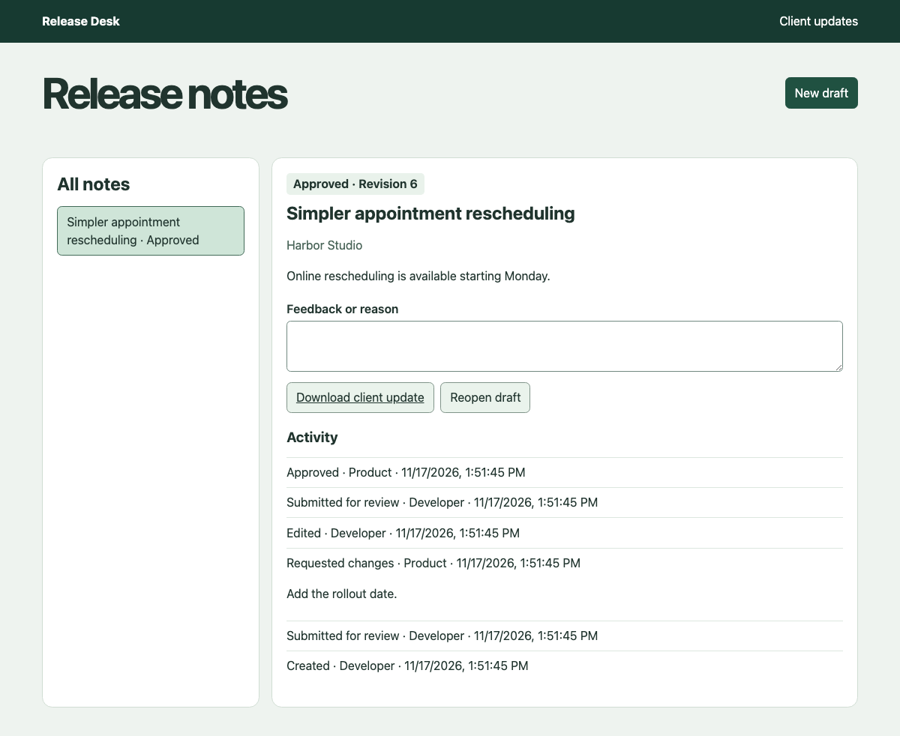

# Release Desk

Turn a developer's draft into a client update through a Product review. Release Desk keeps feedback with the release, records each action and its workflow role, and makes a Markdown export available after approval.



## Run it

Requires Python 3.9 or newer. There are no package dependencies.

```sh
python3 app.py
```

On Windows, run `py app.py`. Open **http://127.0.0.1:8780**. The database lives in `data/` and survives a restart.

## Demo

1. Click **Use example** and **Save draft**. The sample uses fictional data.
2. Submit the saved draft to Product. Enter feedback, such as “Add the rollout date,” and click **Request changes**.
3. Edit the update, save it, and resubmit. Click **Approve** and download the Markdown file. Compare its contents to the approval and feedback in the activity log.
4. Reopen the approved note with a reason. The export becomes unavailable until Product approves a new revision.

## Engineering decisions

- **Explicit state transitions.** The server enforces Draft → In Product review → Approved. Product can return a review to Draft or reopen an approved note.
- **Concurrent updates.** Each mutation supplies the version it read. SQLite serializes writes and checks the version in the same transaction as the update and activity record. If two tabs act on the same revision, one succeeds and the other gets HTTP 409.
- **Approval controls the export.** The export route reads the persisted state and serves only approved content. Reviewer feedback stays in the activity log.
- **Local scope.** Developer and Product are workflow labels in this demo. It runs with a single local operator and demonstrates the approval rules. A shared deployment would need identity, role enforcement, and project access controls.

## Test and publish

```sh
python3 -m unittest discover -s tests -v
```

The tests exercise return and resubmission, export gating, persistence, and competing decisions. GitHub Actions runs the same suite.

Open this folder in Codex and ask it to verify the GitHub account, prepare the first commit, and publish the repository as `release-desk` under your chosen visibility. The project contains a CI workflow and ignores the local database.
